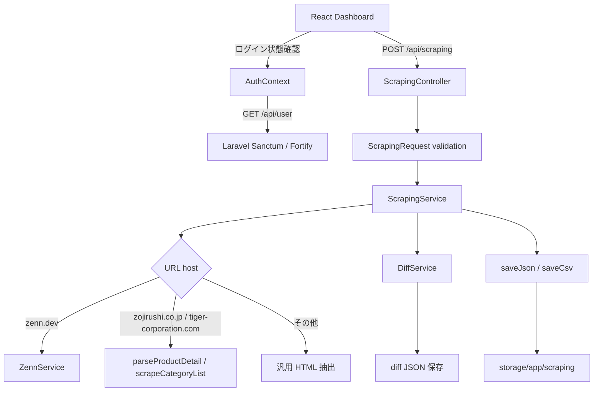
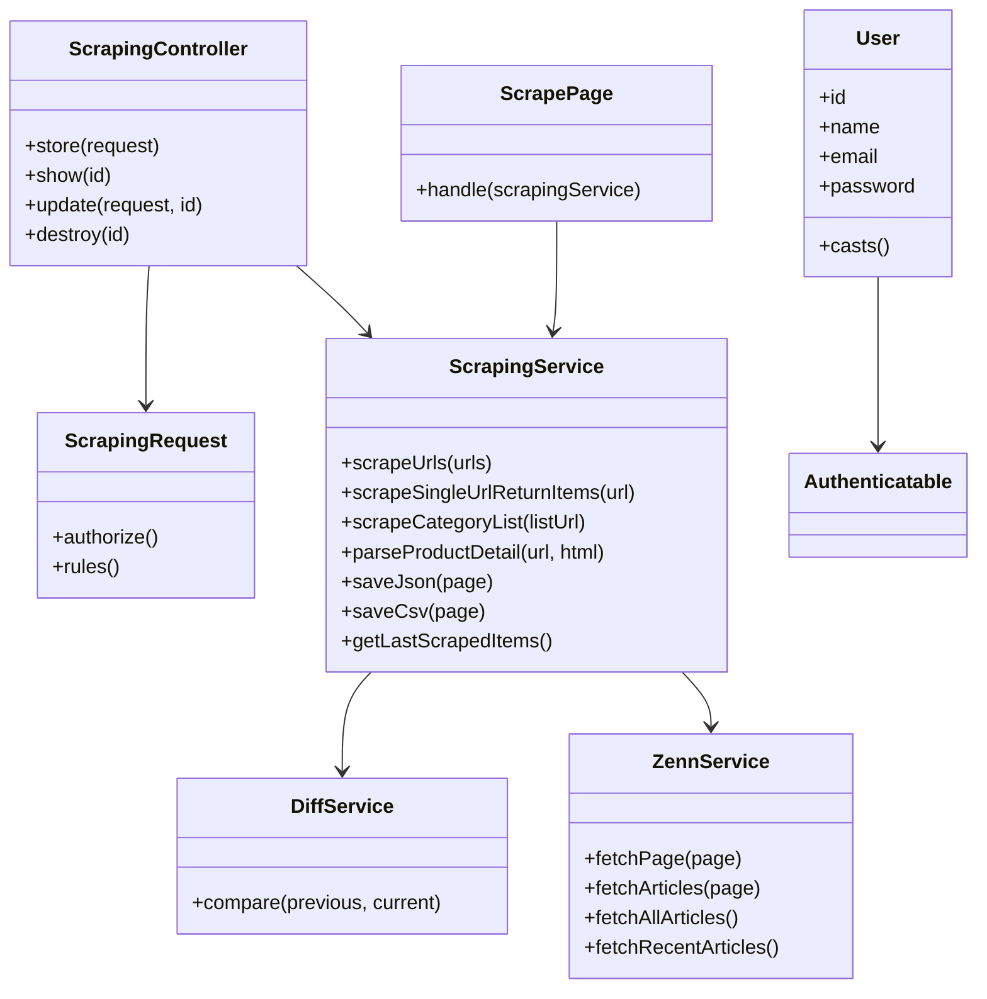

# スクレイピング学習  

 
  


  


  


  

## プロジェクト概要
- Laravel 13ベースのバックエンドと、React + TypeScript + Vite のフロントエンドを含む構成。
- backend 側は Laravel アプリケーション、frontend 側は React SPA。
- Docker Compose で `app` / nginx / `node` / `db(mysql)` / `phpmyadmin` を起動する構成。
- 実装済み機能は、Todo リソースのCRUD APIと、それを呼び出す React フロントエンド。

## 学習・検証目的
- スクレイピング検証の学習
- API と UI 連携の検証

## 主な機能
- ユーザー認証（Fortify）
  - API 認証（Sanctum ミドルウェア適用）
- スクレイピング API
  - 複数 URL の一括スクレイピング
  - 技術記事情報を取得
  - 家電情報を取得
  - 差分比較
- CSV ダウンロード
  - スクレイピング結果の排出

## 使用技術
| カテゴリ | 使用技術 |
| :--- | :--- |
| **Backend** | Laravel 13, PHP `8.5.11` |
| **Frontend** | React `^19.3.1`, Tailwind CSS, Node.js `22.23.4` |
| **Authentication / Authorization** | Fortify |
| **Web Scraping** | `symfony/dom-crawler`, `symfony/css-selector`, `Illuminate\Http\Client\Http` |
| **Infrastructure** | Docker Compose (App / Node / MySQL / Nginx) |
| **OS Environment** | WSL2 (Ubuntu / Alpine Linux) |
| **Database** | MySQL 8.x |

## セットアップ手順

### 1. インフラのビルドと起動
```
docker compose build
docker compose up -d
```

### 2. バックエンド初期化
```
docker compose exec app ash
composer create-project laravel/laravel .
chown -R www-data:www-data storage bootstrap/cache
chmod -R 775 storage bootstrap/cache
```
#### 3. 認証packcageの導入
```
composer require laravel/sanctum
php artisan install:api
composer require laravel/fortify
php artisan fortify:install
```
### 4. フロントエンド初期化
```
docker compose run --rm node sh
npm create vite@latest . -- --template react-ts
npm install
npm install tailwindcss @tailwindcss/vite
```
#### 5. .env修正・作成  
※ バックエンドはcompose.ymlに設定した内容に修正。

#### 6. マイグレーション
```
php artisan migrate
```
#### 7. その他(バックエンド)
```
composer require --dev "squizlabs/php_codesniffer=*"
composer require --dev barryvdh/laravel-debugbar
composer require laravel-lang/lang:~8.0
php artisan lang:publish
cp ./vendor/laravel-lang/lang/json/ja.json ./lang/
cp -r ./vendor/laravel-lang/lang/src/ja ./lang/
composer require phpoffice/phpspreadsheet
composer require symfony/dom-crawler symfony/css-selector
```

#### 8. その他(フロントエンド)
```
docker compose exec node sh
npm install axios
npm list axios
npm install react-router-dom
npm list react-router-dom
npm install @iconify/react
npm install chart.js react-chartjs-2
```

#### 9. 認証の設定
※下記で、`config/core.php`
```
php artisan config:publish cors
```
```
    'allowed_origins' => ['http://localhost:5173'],
    'supports_credentials' => true,
```
## ディレクトリ構成（主要部分）後で修正
- compose.yaml
- php
  - `Dockerfile`
- nginx
  - `default.conf`
- backend
  - `artisan`
  - `composer.json`
  - `package.json`
  - `.env.example`
  - `routes/`
    - `api.php`
    - `console.php`
    - `web.php`
  - `app/`
    - `Actions/`
      - `Fortify/`
    - `Console/`
      - `Commands/`
        - `ScrapePage.php`
    - `Http/`
      - `Controllers/`
        - `Controller.php`
        - `ScrapingController.php`
      - `Requests/`
        - `ScrapingRequest.php`
    - `Models/`
      - `User.php`
    - `Providers/`
      - `AppServiceProvider.php`
      - `FortifyServiceProvider.php`
    - `Services/`
      - `Articles/`
        - `ZennService.php`
      - `DiffService.php`
      - `ScrapingService.php`
  - `database/`
  - `tests/`
  - `storage/`
- frontend
  - `package.json`
  - `src/`
    - `api/`
      - `api.ts`
    - `contexts/`
      - `AuthContext.tsx`
    - `pages/`
      - `Dashboard.tsx`
      - `auth/`
        - `Login.tsx`
        - `Register.tsx`
    - `App.tsx`
    - `main.tsx`
    - `index.css`
  - `public/`
  - `index.html`
  - `vite.config.ts`
  - `tsconfig.json`
- `data/`
- `mysql/`
  - `my.cnf`
---
## 設計・実装の特徴　後で修正
- API を RESTful に定義
- `index()` は `JSON_PRETTY_PRINT | JSON_UNESCAPED_UNICODE` 付きの JSON レスポンス
- `App\Models\User` は PHP 8 の属性ベースで `Fillable` / `Hidden` を定義し、`password` を `hashed` にキャスト
- フロントエンドは React Hooks でシンプルに API 連携し、CRUD 操作を実装

---

## 処理の流れ　後で修正

## クラス構成図　後で修正

## 今後の改善予定
- 多言語でも同様のアプリを作成し、構造比較を行う予定だったが、urlとデータ抽出(APIによる処理を採用)等の問題で題材としてふさわしくないのでfixとする。
